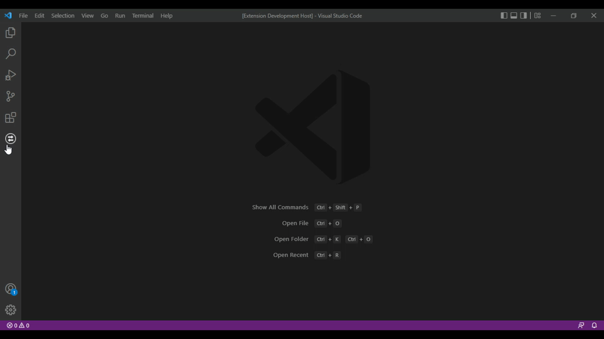

We are happy to share Fetch Client [v1.0.0](https://github.com/Ganesan-Chandran/vscode-fetch-client/releases/tag/v1.0.0) 🎉🎊

This extension helps you test APIs faster and easier, without leaving vscode. 🚀

<!-- truncate -->

## 🎉 New Features

### UI updates

- You can now customize the UI.
- Fetch Client supports VS Code themes.

### API methods

You can test API requests with:

- GET
- POST
- PUT
- PATCH
- DELETE
- HEAD
- OPTIONS

### Authentication support

- Basic Auth
- Bearer Token
- API Key

### Request body types

You can now send:

- Form
- Form-Encoded
- Raw (JSON, Plain Text, XML)
- Binary File
- GraphQL

### Better response view

- Syntax highlight for response data
- Tree view for JSON and XML responses
- HTML preview for HTML responses

### More built-in tools

- History
- Collections
- Environment Variables

### No-code testing

You can test API request and response data without scripts or code.

### Code snippets

Generate code snippets for different languages.

### Save results

Save response data and test results as files.

### Import and export

Import and export Fetch Client collections and environment variables.

### Request notes

Add documentation or feedback for each request.
