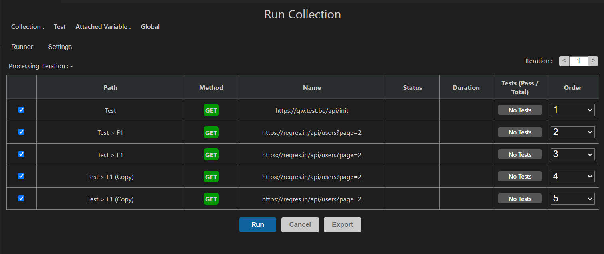
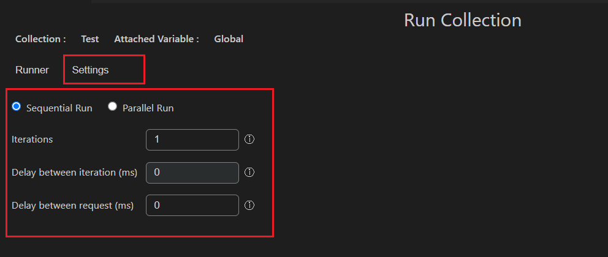

We are happy to share version [**1.3.0**](https://github.com/Ganesan-Chandran/vscode-fetch-client/releases/tag/v1.3.0)🎉.  
This update makes **Run All** more powerful and easier to control. It also fixes a few important problems.

<!-- truncate -->

## 🎉 New Features

- **Settings added in "Run All" Collection** - We added settings for **Run All** Collection. Now you can control how requests run in one place.

- **Multiple iterations support in "Run All"** - You can now run requests for many iterations in **Run All** Collection. This helps when you want to test repeated runs.

- **Delay between requests and iterations** - You can add delay time between requests and also between iterations. This helps avoid sending too many requests too quickly.

- **Sequential or parallel mode for multiple iterations** - For multiple iterations, you can now choose. This gives you more flexibility based on your testing needs.
  - **Sequential mode** to run one by one
  - **Parallel mode** to run at the same time

## 🐛 Bug Fixes

- **Import from cURL fixed** - We fixed issues with **Import from cURL** (issue #5).

- **Duplicate inside folder fixed** - We fixed a bug where items inside a folder could not be duplicated.

## Thank you

Thanks for using Fetch Client and sharing feedback. More updates are coming soon.
